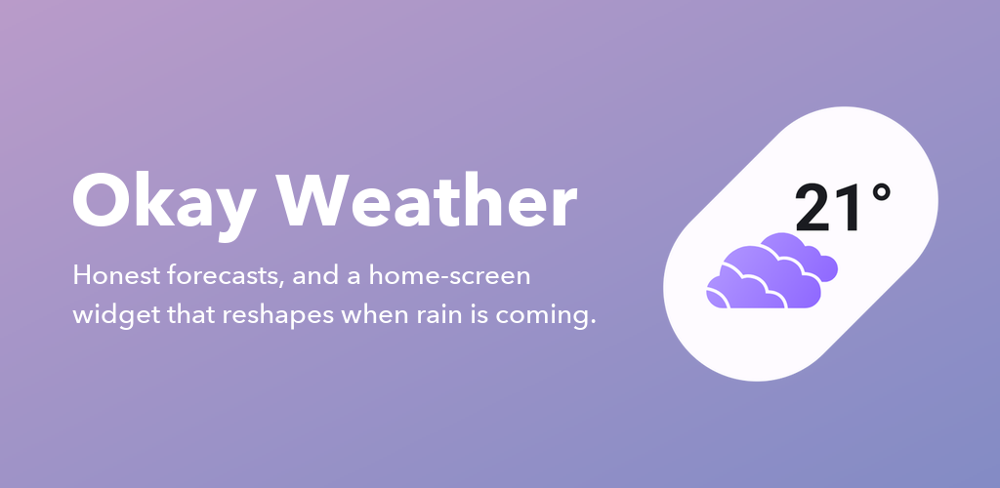
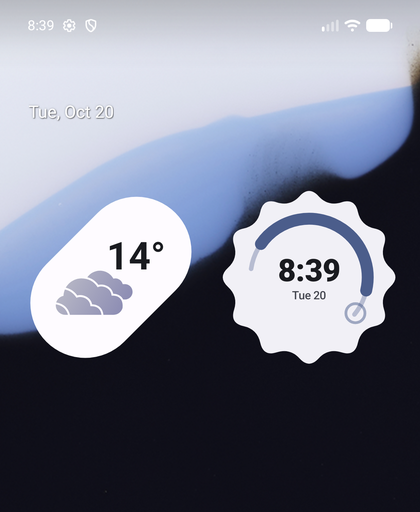
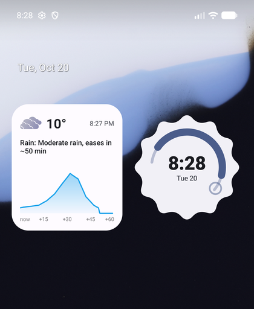
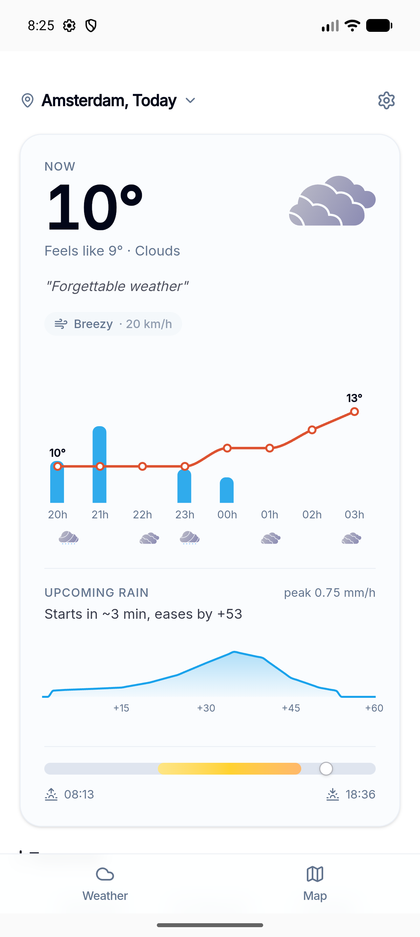
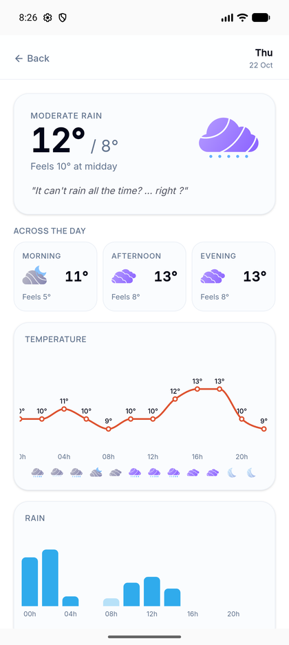
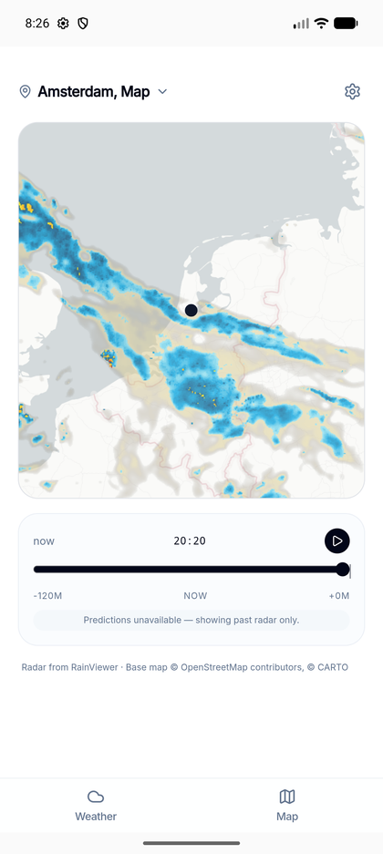
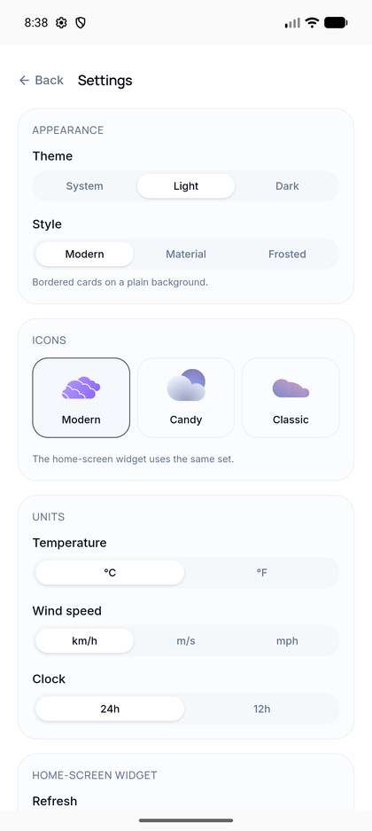

<div align="center">


# Okay Weather

**Honest forecasts, and a home-screen widget that reshapes itself when rain is coming.**

[Open the web app](https://weather.app.roberrini.com/) · [Build it yourself](#run-it-yourself)



</div>

---

Most weather apps bury the one thing you actually want to know: _is it about to
rain on me?_ Okay Weather puts that first — on the home screen, before you open
anything.

## The widget

<table>
<tr>
<td width="50%"></td>
<td width="50%"></td>
</tr>
<tr>
<td><b>Dry.</b> A 45° pill with the temperature and the current conditions. That's all.</td>
<td><b>Rain within the hour.</b> It squares off and shows you when it starts, how long it lasts, and how hard.</td>
</tr>
</table>

It flips between the two on its own, using the same minute-by-minute forecast the
app shows — no setting, no second widget to place.

It also stays current without being opened. Android's background work gets
throttled hard when you haven't touched an app in a day or two, so the refresh
runs on three layers: a Doze-capable alarm, the system's own widget update, and
WorkManager as a backstop. If a reading does go stale, the widget says so rather
than quietly showing you yesterday's weather.

## In the app

<table>
<tr>
<td width="33%"></td>
<td width="33%"></td>
<td width="33%"></td>
</tr>
<tr>
<td><b>Today.</b> Now, the next eight hours, and the next hour of rain as a curve.</td>
<td><b>Any day.</b> Morning, afternoon and evening at a glance, then hour by hour.</td>
<td><b>Radar.</b> Two hours of real radar, scrubbable, over a clean base map.</td>
</tr>
</table>

Ten days, sunrise and sunset, moon phase, air quality, wind, and official weather
alerts where they're published.

## Make it yours



**Three styles.** _Modern_ is bordered cards on a plain background. _Material_
drops the borders and separates sections with colour, taking its palette from
your wallpaper or a colour you pick. _Frosted_ puts translucent cards over a
gradient.

**Three icon sets.** _Modern_, _Candy_ and _Classic_ — the last one is the
original 2020 OkayWeather artwork. The widget follows whichever you choose.

**Units that match how you think.** °C or °F, km/h or m/s or mph, 24-hour or
12-hour.

**Light, dark, or follow the system.**

<br clear="right">

## Where the data comes from

| Source                                                                                         | Used for                                                          |
| ---------------------------------------------------------------------------------------------- | ----------------------------------------------------------------- |
| [OpenWeatherMap One Call 3.0](https://openweathermap.org/api/one-call-3)                       | Current conditions, hourly, 10-day, minute-by-minute rain, alerts |
| [Open-Meteo](https://open-meteo.com)                                                           | Hour-by-hour detail further ahead, and air quality                |
| [RainViewer](https://www.rainviewer.com/api.html)                                              | Radar tiles (past two hours)                                      |
| [CARTO](https://carto.com/basemaps) & [OpenStreetMap](https://www.openstreetmap.org/copyright) | Base map                                                          |

RainViewer discontinued its forecast radar on the free tier in January 2026, so
the map shows past radar only. The _rain prediction_ in the app and the widget
is unaffected — that comes from OpenWeatherMap's minute-by-minute data, not from
the map.

## Run it yourself

Needs [Bun](https://bun.sh) and, for the Android app, Android Studio with a JDK.

```bash
bun install
bun run dev          # http://localhost:8080
```

The Android app is the same web app in a Capacitor shell, plus a native Jetpack
Glance widget:

```bash
bun run build:android    # build the web bundle and sync it into android/
bun run android:open     # open the project in Android Studio
```

Or straight to an APK:

```bash
cd android && ./gradlew assembleDebug
```

## Project layout

```
src/                     the web app (TanStack Start + React + Tailwind)
  lib/settings.ts        appearance and unit preferences
  lib/native.ts          bridge to the Android shell
android/app/src/main/
  java/.../widget/       the Glance widget
  java/.../weather/      fetching, scheduling, widget preferences
  java/.../plugin/       Capacitor plugin: wallpaper palette, widget config
tools/svg_to_vector.py   regenerates the widget's icons from the app's SVGs
tools/make_store_assets.py  builds the Play Store graphics from store/raw
store/                   listing graphics
WORK.md                  build notes, toolchain, and the traps worth knowing
```

## Status

The web app is live. The Android app builds and runs; a Play Store listing is
being prepared — `store/` holds the icon, feature graphic and screenshots for it.

## License

[MIT](LICENSE). The weather icon sets are the author's own work and are covered
by the same licence; map and forecast data belong to the providers listed above
and carry their own terms.
